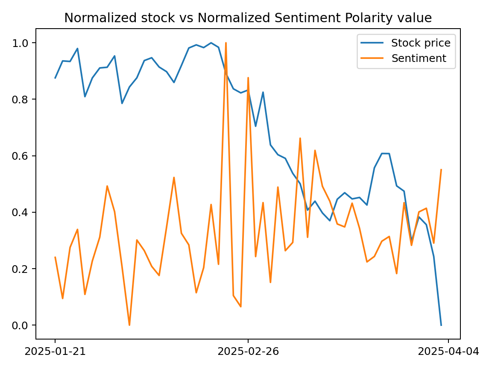
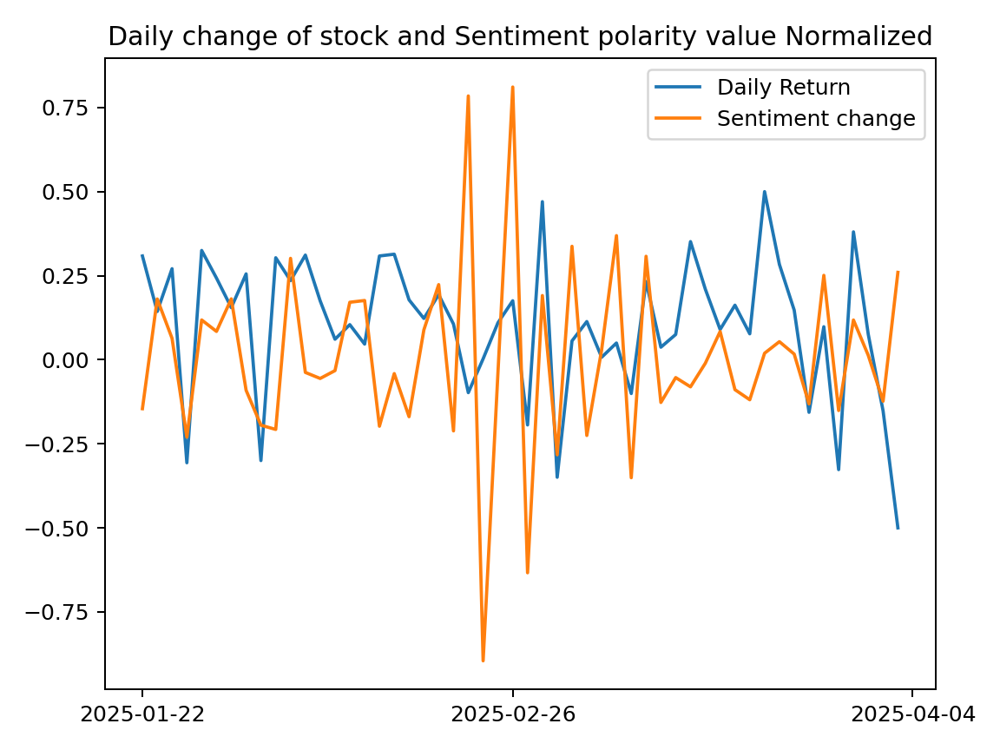
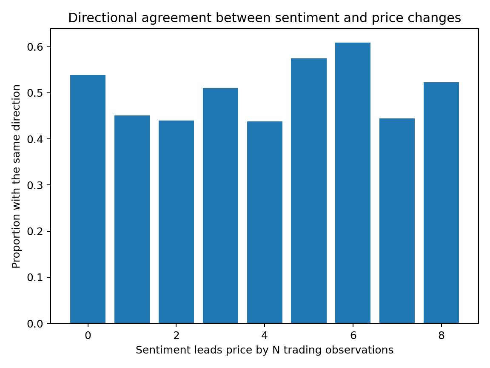
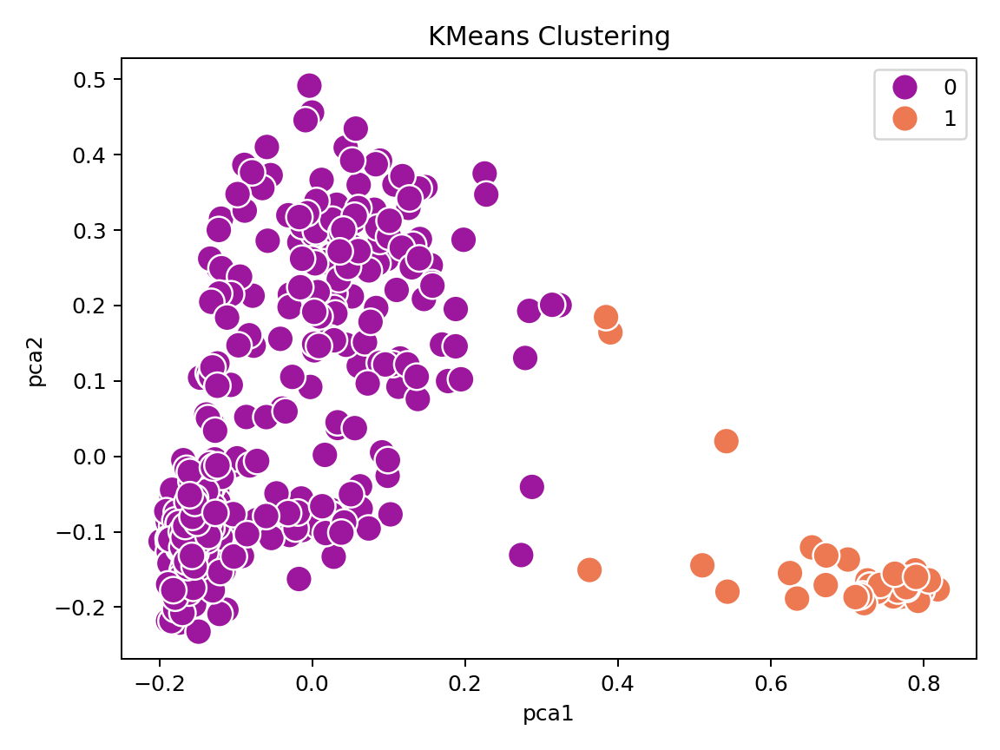
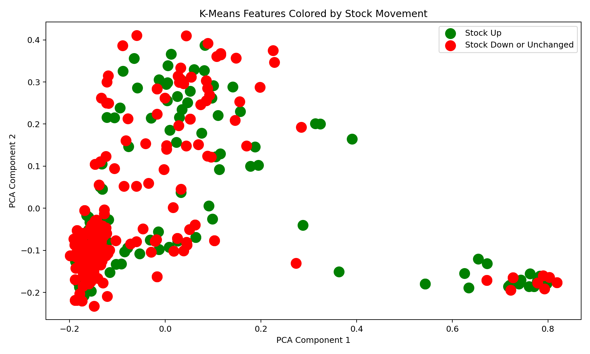

# The White House and the Stock Market

Created by Teddy Pomianek, Neil Keltcher, and Bryan Ma.

## About the Project

This project explores whether the language used in White House publications is related to changes in the stock market.

We collected White House articles, statements, and presidential actions from January 20 through April 4, 2025. We then compared their sentiment with the price of VOO, an ETF that tracks the S&P 500.

The project uses Python to collect data, analyze text, compare daily changes, and visualize patterns.

## What We Did

- Collected White House publication dates and text using BeautifulSoup and Requests.
- Downloaded VOO stock prices using yfinance.
- Used TextBlob to score how positive or negative each document sounded.
- Calculated average sentiment for each day.
- Compared sentiment and stock prices using line graphs.
- Compared the direction of sentiment and price changes at different time delays.
- Used TF-IDF, PCA, and K-means to explore similarities between documents.

## Visualizations

### Stock Price and Sentiment

This graph compares VOO's opening price with average daily sentiment. Both are scaled from 0 to 1 so they can be shown together.

### Daily Changes

This graph compares scaled changes in VOO's opening price with changes in normalized average sentiment. These are transformed values, not dollar changes or percentage returns.

### Comparing Different Time Delays

This graph shows how often sentiment and stock prices changed in the same direction.

A delay of 0 compares changes on the same day. A delay of 1 compares the previous trading day's sentiment change with the current day's price change.

### PCA and K-Means

We used TF-IDF to turn the text into numerical features based on word usage. PCA reduced those features to two dimensions so we could plot them.

K-means then divided the documents into two groups. Each point is a document, and its color shows its group. These groups are based on similarities in the text, not whether the documents are positive or negative.

### Document Groups and Stock Movement

This graph uses the same PCA coordinates, but colors the documents by whether VOO's opening price went up or did not go up on their publication date.

This lets us look for patterns between document content and stock movement.

## Project Report

The original report explains our research question, data collection, sentiment analysis, stock comparisons, volatility methods, and conclusions.

The PCA and K-means work is included in the code and shown above, but is not discussed in the report.

[Read the project report](Project%20Report.pdf)

**Note about the original report:** The PDF is our original course submission. The current code corrects date matching and time-delay calculations and uses newly downloaded stock prices, so its graphs may differ from the report. The report discusses closing prices and volatility, while the current analysis uses opening prices and does not calculate annualized volatility. Its title also mentions linear regression, but the supplied scripts do not fit a regression model. The report's claim of a clear positive relationship has not been validated by the corrected analysis and should be treated as an exploratory interpretation.

## Files

- `White house scrape.py`: Collects text and publication dates from the White House website.
- `stock_data.py`: Downloads VOO prices and saves them to `stock_data.csv`.
- `Sentiment analysis.py`: Runs the analysis and saves the graphs.
- `Whitehouse_scrape_APR_6.csv`: The original White House dataset.
- `stock_data.csv`: Historical VOO prices downloaded again for this version.
- The PNG files in this folder are the images displayed in this README. New runs save images in a `figures` folder.
- `requirements.txt`: Python packages needed to run the project.
- `Project Report.pdf`: The original written report.

## How to Run

Keep the files together and open the folder in VS Code. Select your Python environment, then run:

python -m pip install -r requirements.txt

With both CSV files in the folder, run:

python "Sentiment analysis.py"

The graphs will be saved in the figures folder.

To download the stock data again, run:

python stock_data.py

You do not need to run the White House scraper again because the original CSV is included.

## Notes

This version keeps the original project's structure, with small corrections to date matching, time-delay comparisons, and file handling. It also saves the graphs so they can appear in the README.

The graphs were generated again using the recovered White House data and newly downloaded stock prices, so they may differ from the original report.

This is an exploratory project. The graphs can help identify patterns, but they do not prove that White House statements caused stock prices to change or that they can predict future prices.
