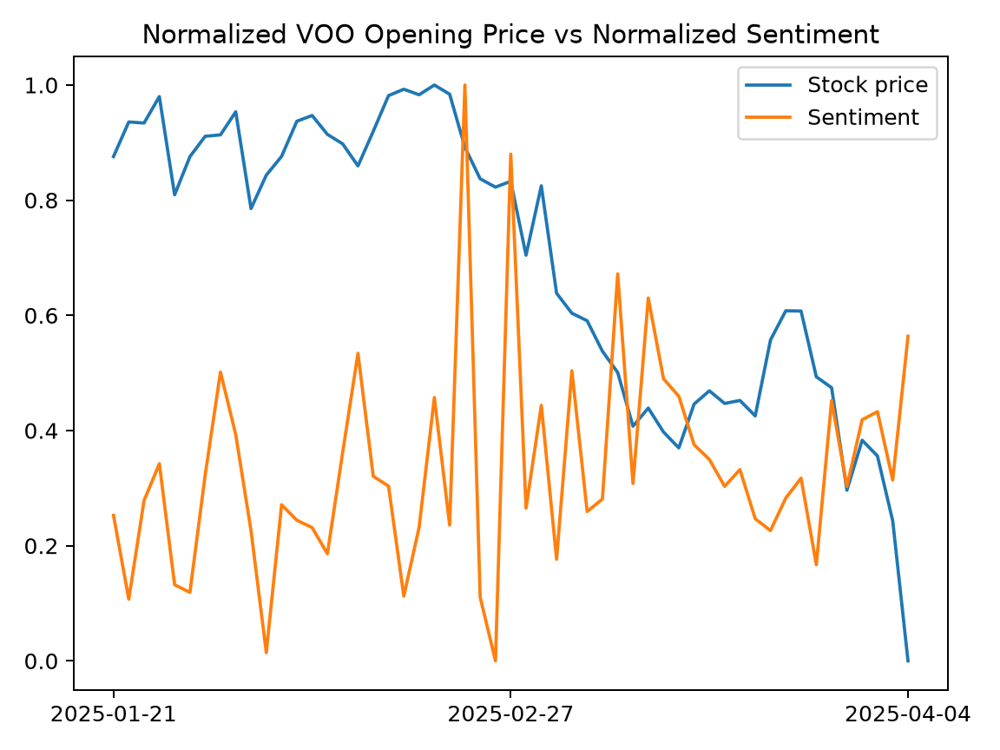
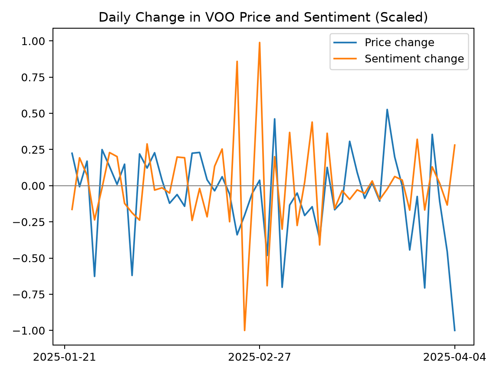
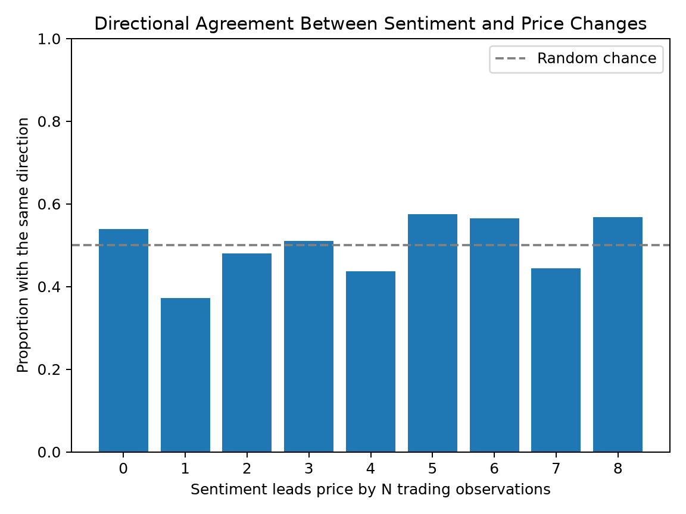
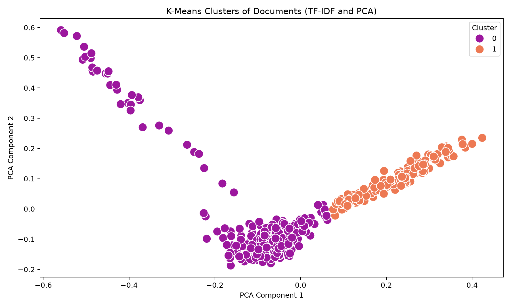
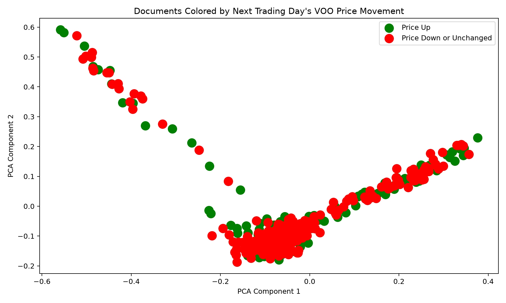

# The White House and the Stock Market

Created by Teddy Pomianek, Neil Keltcher, and Bryan Ma. Revised analysis by Teddy Pomianek.

## About the Project

This project examines whether the tone of White House publications is related to movements in the stock market.

We collected all articles, statements, fact sheets, remarks, and presidential actions published by the White House between January 20 and April 4, 2025. Each document was scored for positive or negative sentiment, and those scores were compared with the price of VOO, an ETF that tracks the S&P 500.

## Findings

The analysis did not find a meaningful relationship between White House sentiment and market movement.

- Directional agreement between sentiment and VOO's price was measured on the same day and at delays of up to 8 trading days. Agreement ranged from approximately 0.37 to 0.58, which is consistent with random chance.
- The largest deviation occurred at a delay of 1, where prices moved opposite to the previous day's sentiment change approximately 63% of the time. Given only about 50 observations and nine delays tested, a single result of this size is likely to occur by chance.
- VOO declined from late February into April, but sentiment did not follow a corresponding trend, and the daily movements did not align.
- K-means divided the documents into two groups based on word usage. When the same documents were colored by the following trading day's price movement, no pattern was visible.

## Methodology

- Scraped publication dates and text from the White House website using BeautifulSoup and Requests.
- Cleaned the text and removed duplicate documents.
- Retrieved daily VOO prices using yfinance.
- Scored each document's sentiment with TextBlob, which assigns a polarity from -1 (negative) to 1 (positive), and averaged the scores for each day.
- Retained only dates with both trading data and at least one publication.
- Compared the direction of daily sentiment and price changes at delays of 0 to 8 trading days.
- Converted the text into TF-IDF features, reduced them to two dimensions with PCA, and grouped the documents with K-means.

## Visualizations

### Stock Price and Sentiment

VOO's opening price and average daily sentiment, both scaled from 0 to 1 so they can be displayed on the same chart.



### Daily Changes

Daily changes in VOO's price and in sentiment. Both series are scaled to fall between -1 and 1, so values above 0 represent increases and values below 0 represent decreases.



### Directional Agreement at Different Delays

The proportion of observations in which sentiment and price moved in the same direction. A delay of 0 compares changes on the same day. A delay of 1 compares the previous day's sentiment change with the current day's price change, and so on. The dashed line at 0.5 represents the agreement expected from random chance.

Because the analysis uses opening prices, which are set before most same-day publications, a delay of 1 is the first comparison in which sentiment precedes the price change.



### PCA and K-Means

Each point represents a document, positioned according to its word usage. Documents with similar language appear close together. The colors indicate the two groups identified by K-means, which reflect differences in topic and wording rather than positive or negative tone.



### Document Groups and Stock Movement

The same chart, colored by whether VOO's price rose at the first market open following each document's publication. Documents published on weekends are matched to the following Monday.



## Changes from the Original Report

The [original report](Project_Report.pdf) is our group's course submission. Following the course, I revised the analysis to correct several issues, so the graphs and conclusions presented here differ from the report:

- Corrected the matching of publications to trading days and the delay calculation.
- Removed duplicate documents and cleaned the text format.
- Matched documents to the following trading day's price movement, since opening prices are set before most same-day publications.
- Used newly downloaded VOO prices, and opening prices rather than closing prices.
- Removed the annualized volatility analysis included in the report.
- Added the PCA and K-means analysis, which the report does not include.
- The report's title references linear regression, but no regression model was fit.
- The report concluded that a clear positive relationship existed based on visual inspection of the graphs. Measuring how often the two series moved in the same direction does not support that conclusion.

## Files

| File | Description |
| --- | --- |
| `whitehouse_scrape.py` | Scrapes text and publication dates from the White House website |
| `stock_data.py` | Downloads VOO prices and saves them to `stock_data.csv` |
| `sentiment_analysis.py` | Runs the analysis and saves the graphs |
| `Whitehouse_scrape_APR_6.csv` | White House documents, scraped April 6, 2025 |
| `stock_data.csv` | Daily VOO prices |
| `*.png` | Graphs displayed in this README |
| `Project_Report.pdf` | Original course report |
| `requirements.txt` | Required Python packages |

## How to Run

```bash
pip install -r requirements.txt
python sentiment_analysis.py
```

The graphs are saved to the project folder and replace those displayed in this README. To download new stock data, run `python stock_data.py`. The scraper does not need to be rerun, as the original dataset is included and the White House website has changed since the data was collected.

## Limitations

This was an exploratory project covering a short period of approximately 50 trading days. TextBlob is a general-purpose sentiment tool and was not designed for political or financial language. White House publications are written by the administration, so their tone is not a neutral measure of events. Even if a pattern had been observed, it would not demonstrate that White House statements cause or predict market movements.
